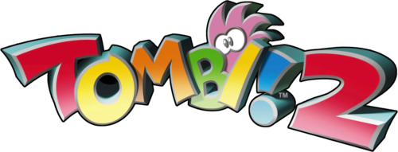

<p align="center">&nbsp;</p>

# Tombi! 2 / Tomba! 2: The Evil Swine Return decomp

[](#building)
[](docs/COMPILER.md)
[](#building)

A work-in-progress **matching decompilation** of *Tombi! 2* (*Tomba! 2: The Evil Swine Return* in North America,
*Tombi! 2: Contra los cerdiablos* in Spain), Whoopee Camp, PlayStation, 1999: the game's code rewritten as C that
compiles, with the original compiler, into exactly the machine code on the disc.

It follows the method and the tools of [Tombi-Decomp](https://github.com/afsenovilla/Tombi-Decomp), the first
game, fully matched and ported to PC and Android. A native port of the second game is the long-term goal; the
decompilation comes first and stays byte for byte.

> This repository contains no game data, executables, disc images or Sony SDK files.
> You need your own legally obtained copy of the game; the build reads it from `game/`.

## Progress

Reference version: USA, *Tomba! 2* (SCUS-94454). A function counts as done when its C compiles to exactly the
bytes of the disc; everything else is still built from the original assembly, so the whole game rebuilds
byte-identical at every step.

<!-- progress:start -->
**Whole game: 30.9 % of the code matches byte for byte** (874444 of 2827992 bytes, 4128 of 7011 functions; 2026-11-23).

| Part | Functions | Bytes | Matching (bytes) |
|---|---:|---:|---|
| 1. Psy-Q library (MAIN + boot) | 746 / 873 | 93280 / 174272 | 🟩🟩🟩🟩🟩⬜⬜⬜⬜⬜ 53.5 % |
| 2. MAIN.EXE engine | 723 / 1169 | 138336 / 409140 | 🟩🟩🟩⬜⬜⬜⬜⬜⬜⬜ 33.8 % |
| 3. boot + game/demo/opn/sop/crd | 106 / 153 | 31480 / 70648 | 🟩🟩🟩🟩⬜⬜⬜⬜⬜⬜ 44.6 % |
| 4a. small areas a0g-a0j | 138 / 158 | 44216 / 61632 | 🟩🟩🟩🟩🟩🟩🟩⬜⬜⬜ 71.7 % |
| 4b. medium areas + bosses | 665 / 1020 | 202460 / 502332 | 🟩🟩🟩🟩⬜⬜⬜⬜⬜⬜ 40.3 % |
| 4c. big areas a00-a08 | 1750 / 3638 | 364672 / 1609968 | 🟩🟩⬜⬜⬜⬜⬜⬜⬜⬜ 22.7 % |

<details>
<summary><b>Per program</b> (game code, without the Psy-Q library)</summary>

| Program | Functions | Bytes | Matching (bytes) |
|---|---:|---:|---|
| SCUS_944.54: boot | 8 / 13 | 876 / 3300 | 🟩🟩🟩⬜⬜⬜⬜⬜⬜⬜ 26.5 % |
| MAIN.EXE: engine | 723 / 1169 | 138336 / 409140 | 🟩🟩🟩⬜⬜⬜⬜⬜⬜⬜ 33.8 % |
| GAME.BIN | 27 / 33 | 6384 / 11236 | 🟩🟩🟩🟩🟩🟩⬜⬜⬜⬜ 56.8 % |
| DEMO.BIN | 9 / 15 | 2268 / 5152 | 🟩🟩🟩🟩⬜⬜⬜⬜⬜⬜ 44.0 % |
| OPN.BIN: opening | 9 / 16 | 2308 / 12860 | 🟩🟩⬜⬜⬜⬜⬜⬜⬜⬜ 17.9 % |
| SOP.BIN | 26 / 41 | 6160 / 14328 | 🟩🟩🟩🟩⬜⬜⬜⬜⬜⬜ 43.0 % |
| CRD.BIN: credits | 27 / 35 | 13484 / 23772 | 🟩🟩🟩🟩🟩🟩⬜⬜⬜⬜ 56.7 % |
| A00.BIN: area overlay | 247 / 511 | 56648 / 247424 | 🟩🟩⬜⬜⬜⬜⬜⬜⬜⬜ 22.9 % |
| A01.BIN: area overlay | 225 / 406 | 50672 / 173892 | 🟩🟩🟩⬜⬜⬜⬜⬜⬜⬜ 29.1 % |
| A02.BIN: area overlay | 178 / 306 | 40692 / 122524 | 🟩🟩🟩⬜⬜⬜⬜⬜⬜⬜ 33.2 % |
| A03.BIN: area overlay | 12 / 43 | 1868 / 35128 | 🟩⬜⬜⬜⬜⬜⬜⬜⬜⬜ 5.3 % |
| A04.BIN: area overlay | 207 / 474 | 45628 / 218464 | 🟩🟩⬜⬜⬜⬜⬜⬜⬜⬜ 20.9 % |
| A05.BIN: area overlay | 208 / 470 | 40192 / 200480 | 🟩🟩⬜⬜⬜⬜⬜⬜⬜⬜ 20.0 % |
| A06.BIN: area overlay | 236 / 519 | 49096 / 227456 | 🟩🟩⬜⬜⬜⬜⬜⬜⬜⬜ 21.6 % |
| A07.BIN: area overlay | 174 / 373 | 31412 / 159552 | 🟩🟩⬜⬜⬜⬜⬜⬜⬜⬜ 19.7 % |
| A08.BIN: area overlay | 263 / 536 | 48464 / 225048 | 🟩🟩⬜⬜⬜⬜⬜⬜⬜⬜ 21.5 % |
| A09.BIN: area overlay | 32 / 51 | 8128 / 20364 | 🟩🟩🟩🟩⬜⬜⬜⬜⬜⬜ 39.9 % |
| A0A.BIN: area overlay | 87 / 133 | 27960 / 64328 | 🟩🟩🟩🟩⬜⬜⬜⬜⬜⬜ 43.5 % |
| A0B.BIN: area overlay | 68 / 107 | 25832 / 61368 | 🟩🟩🟩🟩⬜⬜⬜⬜⬜⬜ 42.1 % |
| A0C.BIN: area overlay | 81 / 121 | 27264 / 63832 | 🟩🟩🟩🟩⬜⬜⬜⬜⬜⬜ 42.7 % |
| A0D.BIN: area overlay | 72 / 106 | 24288 / 57812 | 🟩🟩🟩🟩⬜⬜⬜⬜⬜⬜ 42.0 % |
| A0E.BIN: area overlay | 79 / 114 | 24720 / 60716 | 🟩🟩🟩🟩⬜⬜⬜⬜⬜⬜ 40.7 % |
| A0F.BIN: area overlay | 95 / 140 | 28832 / 71340 | 🟩🟩🟩🟩⬜⬜⬜⬜⬜⬜ 40.4 % |
| A0G.BIN: area overlay | 29 / 38 | 9924 / 16684 | 🟩🟩🟩🟩🟩🟩⬜⬜⬜⬜ 59.5 % |
| A0H.BIN: area overlay | 32 / 35 | 10688 / 13488 | 🟩🟩🟩🟩🟩🟩🟩🟩⬜⬜ 79.2 % |
| A0I.BIN: area overlay | 29 / 33 | 10272 / 14624 | 🟩🟩🟩🟩🟩🟩🟩⬜⬜⬜ 70.2 % |
| A0J.BIN: area overlay | 48 / 52 | 13332 / 16836 | 🟩🟩🟩🟩🟩🟩🟩🟩⬜⬜ 79.2 % |
| A0K.BIN: area overlay | 78 / 139 | 19008 / 61688 | 🟩🟩🟩⬜⬜⬜⬜⬜⬜⬜ 30.8 % |
| A0L.BIN: area overlay | 73 / 109 | 16428 / 40884 | 🟩🟩🟩🟩⬜⬜⬜⬜⬜⬜ 40.2 % |

</details>
<!-- progress:end -->

The library part is Sony's Psy-Q 4.4 code linked into the game (`src/<prog>/psyq/`), counted together with the
library functions kept as assembly on purpose (they were written in assembly). Updated with
`python3 -I tools/readme_progress.py`.

## Releases

| Release | Serial | Status |
|---|---|---|
| USA, *Tomba! 2: The Evil Swine Return* (reference) | SCUS-94454 | all 29 programs rebuild byte-identical; C in progress (above) |
| Europe, *Tombi! 2* | SCES-02147 | all 29 programs rebuild byte-identical (`--version eu`); ~96 % of the USA functions found in it |
| Spain, *Tombi! 2: Contra los cerdiablos* | SCES-02687 | ~96 % of the USA functions found in it |

The 29 programs: the boot executable, `MAIN.EXE` (the engine), the area overlays `A00`..`A0L` and the `GAME`,
`DEMO`, `OPN`, `SOP` and `CRD` overlays ([docs/DISCS.md](docs/DISCS.md)).

## Building

```bash
bash tools/session_bootstrap.sh
```

or by hand: install `binutils-mipsel-linux-gnu`, `pip install -r tools/requirements.txt` and
`pip install --no-deps splat64==0.35.2`, put the disc's files in `game/usa/` (`bash tools/disc_fetch.sh USA` with
`GAME_FILES_URL_T2_USA` set to a link to your copy), then

```bash
python3 tools/build.py
```

Every program prints `OK` when its rebuilt file is byte-identical to the original.

## How the work is done

- `tools/build.py`: splat split, C compiled with the game's compiler (GCC 2.8.1 + ASPSX 2.79 through maspsx),
  link, SHA-1 compared with the disc's file. C `switch` statements reuse the disc's jump tables (`tools/jtbl.py`).
- `tools/ccheck.py`: compile one scratch C file and compare each function with the retail bytes (`--sbs`, or
  `tools/sbs.py`: side-by-side diff of ours and retail); `tools/install_c.py` puts matched functions in place
  (linked-build checked, symbols renamed to the program's names from the relocations).
- `tools/sweep.py` (m2c drafts that match as they are; m2c gets the jump tables), `tools/hillclimb.py` (small
  source transforms that bring drafts closer), `tools/permute.py` (decomp-permuter), `tools/permlines.py`
  (statement-order search over lines marked `//P`), `tools/variants.py` (several variants of one function in a file),
  `tools/magicdiv.py` (the divisor behind a magic-number multiply).
- `tools/dupsweep.py`: the area overlays share many functions; one matched copy is installed in every other copy,
  also when they differ only in constants. `tools/nearcopy.py` does the same for near copies (a few differing
  words, patched constants and offsets) and lists the closest C for hand matching.
- `tools/libsweep.py` and friends: the Psy-Q library, by signature.

## Documents

- [docs/ROADMAP.md](docs/ROADMAP.md): the phases, step by step.
- [docs/STATUS.md](docs/STATUS.md): current state, recipes for hand matching, next steps.
- [docs/DISCS.md](docs/DISCS.md): the three discs, executables, overlays, load addresses, library version.
- [docs/COMPILER.md](docs/COMPILER.md): how the compiler was identified.
- [docs/TOMBA2EDIT.md](docs/TOMBA2EDIT.md): what [Tomba2Edit](https://github.com/SiergiejW/Tomba2Edit) contributed
  (names, formats).
- [docs/PLAN.md](docs/PLAN.md): function counts and the order of work.

## Thanks

[Tomba2Edit](https://github.com/SiergiejW/Tomba2Edit) by SiergiejW for the function names and file formats;
[splat](https://github.com/ethteck/splat), [maspsx](https://github.com/mkst/maspsx),
[m2c](https://github.com/matt-kempster/m2c) and [decomp-permuter](https://github.com/simonlindholm/decomp-permuter).
See [THIRD_PARTY_NOTICES.md](THIRD_PARTY_NOTICES.md).
